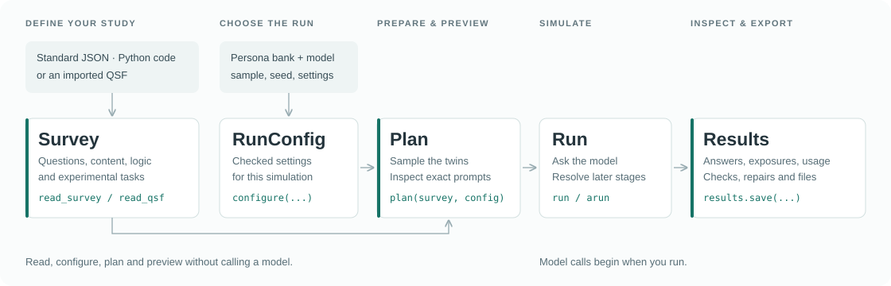

# surveytwin

A Python toolkit for defining surveys and experiments, preparing their materials for language models, and running digital-twin simulations.

Specify what each twin sees and answers: instructions, text, images, tables, response options and survey logic. `surveytwin` prepares the prompts, runs the survey with your chosen persona bank and model, and records answers in structured outputs.

Build a survey in Python, load a standard definition, or import a Qualtrics QSF. Preview the prompts before running, then inspect and export the results.



## Contents

- [Install](#install)
- [Quick start](#quick-start)
- [How a run fits together](#how-a-run-fits-together)
- [Questions and survey definitions](#questions-and-survey-definitions)
- [Step by step](#step-by-step)
- [Build and edit a survey in Python](#build-and-edit-a-survey-in-python)
- [Models and API keys](#models-and-api-keys)
- [Persona banks](#persona-banks)
- [Command line](#command-line)
- [Reproducibility](#reproducibility)
- [Reference](#reference)

## Install

Use Python 3.11 or later.

```bash
pip install surveytwin
```

For pandas and Parquet support:

```bash
pip install "surveytwin[pandas,parquet]"
```

The examples below use sample files from this repository. Download it and run the examples from its root folder.

## Quick start

Set `OPENAI_API_KEY` in your environment and replace `YOUR_MODEL_NAME` with your model ID. `run` makes provider calls.

```python
import surveytwin as st

survey = st.read_survey("examples/survey-format/coffee-habits.json")
config = st.configure(
    bank="examples/example-bank", sample_size=3, seed=7,
    model=st.Model.openai("YOUR_MODEL_NAME"),
)
plan = st.plan(survey, config)
print(plan.preview_prompt())
results = st.run(plan)
results.save("runs/coffee-habits")
```

## How a run fits together

- **Read or build:** `read_survey`, `new_survey` or `read_qsf` returns a `Survey`.
- **Configure:** `configure` returns the persona, model and sampling settings in a `RunConfig`.
- **Prepare:** `plan(survey, config)` samples twins and prepares their survey versions.
- **Preview:** `plan.preview_prompt()` shows what a twin will receive.
- **Run:** `run(plan)` or asynchronous `arun(plan)` returns `Results`.
- **Save:** `results.save(...)` writes the responses, exports and run records.

Reading, configuring, planning and previewing do not call a language model.

## Questions and survey definitions

Use [the question guide](questions-guide.md) to choose question types and configure responses, pictures, tables, conditions, conjoint and MaxDiff. It includes Python examples and an index of supported types.

A standard definition has `questions`, `blocks` and `flow`. Load it with `read_survey("study.json")`, or pass a Python dictionary. Use `survey.standard` to inspect or save the definition.

Start with one of the repository examples:

- [Coffee habits](examples/survey-format/coffee-habits.json): questions, conditions, piping and repeated blocks.
- [Coffee-shop choices](examples/survey-format/coffee-conjoint.json): a choice-based conjoint study.
- [Shopping features](examples/survey-format/feature-maxdiff.json): a MaxDiff study.

To import an existing Qualtrics survey, use `st.read_qsf("study.qsf")`. The imported survey follows the same workflow. See the [format reference](docs/reference/survey-format.md) for the complete JSON specification.

## Step by step

The following steps use the coffee survey and example bank.

### 1. Read and inspect the survey

```python
survey = st.read_survey("examples/survey-format/coffee-habits.json")
print(survey)
print(survey.check())
print(survey.preview_blocks())
```

The survey contains 14 questions and 7 blocks. Inspect the check and block previews before preparing a run. To exclude blocks, assign the result of `survey.drop_blocks([...])` to a new survey.

### 2. Choose the personas

Open a bank and inspect its available representations and filters:

```python
bank = st.bank("examples/example-bank")
print(bank.representations())
print(bank.filter_options())
```

Preview the audience you want to sample:

```python
filters = {"region": ["South", "West"], "age": {"max": 50}}
print(bank.preview_filter(filters))
```

Three example personas match. A representation selects the text describing each persona, such as Summary or Demographics.

### 3. Configure the run

```python
model = st.Model.openai("YOUR_MODEL_NAME")
config = st.configure(
    bank=bank, representation="Summary", filters=filters,
    sample_size=3, seed=7, model=model,
)
```

Set `sample_size`, `seed`, `representation`, `filters` and `model` for your study. For other providers, see [Models and API keys](#models-and-api-keys).

### 4. Plan and preview

```python
plan = st.plan(survey, config)
print(plan)
print(plan.preview_prompt())
pilot_plan = plan.head(1)
```

`head(1)` keeps the first selected twin and its prepared assignments for a pilot.

Static surveys can be answered in one call per twin. Staged surveys resolve later questions from earlier answers. For a staged survey, the preview shows the first stage; later prompts are built during the run. The plan also reports repeated-block workload and stage warnings.

### 5. Run

```python
results = st.run(plan, max_concurrency=3, keep_prompts=True)
```

Set `max_concurrency` to limit concurrent twins. Use `keep_prompts=True` to retain the requests used during execution.

In asynchronous code or a notebook with an active event loop, use this instead:

```python
results = await st.arun(plan, max_concurrency=3, keep_prompts=True)
```

### 6. Inspect and save the results

```python
for answer in results.answers[:5]:
    print(answer.twin_id, answer.question_id, answer.label, answer.status)

print(results.flagged())
print(results.usage_totals)
results.save("runs/coffee-habits")
```

The run folder includes long and wide CSVs, per-twin text, the survey definition, usage and audit records, validation reports and reloadable results. Experiment runs also include exposure CSVs. Qualtrics-style label and value exports are available.

Load a saved run with:

```python
loaded = st.Results.load("runs/coffee-habits")
```

For pandas, call `results.to_pandas()`. For individual files, use `to_long_csv`, `to_wide_csv` or `to_qualtrics_csv`.

To re-ask flagged answers, use:

```python
repaired = results.rerun_flagged(model=model, max_concurrency=3)
repaired.save("runs/coffee-habits-repaired")
```

Repairs make additional model calls and are stored beside the original answers. Dependent answers are marked; the dependent survey path is not rerun automatically.

## Build and edit a survey in Python

Start with `new_survey` and add questions:

```python
built = st.new_survey("Drink preference")
built = built.add_question(
    "single_choice", "Which drink would you choose?",
    id="drink", options=["Coffee", "Tea"], required=True,
)
built = built.add_question("text", "Why?", id="reason", max_length=200)
```

Each edit returns a new survey. Assign the result to keep the change:

```python
built = built.update_question("reason", text="What do you like about that drink?")
built = built.add_question("number", "How many cups a day?", id="cups", min=0, max=12)
built = built.move_question("cups", before="reason")
```

Use the built survey with the same `configure`, `plan` and `run` functions. See [the question guide](questions-guide.md) for all types and [survey editing](docs/reference/survey.md#editing-a-survey) for block and question operations.

For a draft from an existing form, `st.builder.build_survey(draft)` remains available. See the [draft-builder reference](docs/reference/builder.md).

## Models and API keys

Choose a built-in connection:

```python
openai = st.Model.openai("YOUR_MODEL_NAME")
router = st.Model.openrouter("YOUR_MODEL_NAME")
claude = st.Model.anthropic("YOUR_CLAUDE_MODEL")
gemini = st.Model.gemini("YOUR_GEMINI_MODEL")
deepseek = st.Model.deepseek("deepseek-flash")
```

Set the corresponding environment variable:

- OpenAI: `OPENAI_API_KEY`
- OpenRouter: `OPENROUTER_API_KEY`
- Anthropic: `ANTHROPIC_API_KEY`
- Gemini: `GEMINI_API_KEY`
- DeepSeek: `DEEPSEEK_API_KEY`

```bash
export OPENAI_API_KEY="YOUR_API_KEY"
```

Pass the chosen model to `configure(model=...)`. Use `api_key_env="MY_KEY"` to select another environment variable, or pass a key to `run(plan, api_key=...)`. Load `.env` files yourself if you use them.

For another endpoint or client, use `Model.openai_compatible`, `Model.http` or `Model.from_function`. Use `st.env("VARIABLE_NAME")` for credentials in custom HTTP settings. See the [model reference](docs/reference/models.md) for request layouts and provider options.

## Persona banks

Open a Croissant Twins folder or zip with `st.bank(path)`, then pass the bank to `configure`. Choose an available representation or use `representation="empty"` for a baseline without persona text.

The example bank is included in the repository, rather than installed with the wheel. The default Twin-2K-500 bank is not yet publicly downloadable. To use your local copy, set:

```bash
export SURVEYTWIN_TWIN2K_BANK="/path/to/twin-2k-500-ct"
```

See [persona banks](docs/reference/personas.md) for the bank format, representations and filters.

## Command line

Installation provides the `surveytwin` command:

```bash
surveytwin check examples/survey-format/coffee-habits.json
surveytwin prompts examples/survey-format/coffee-habits.json --bank examples/example-bank --twins 3
surveytwin run examples/survey-format/coffee-habits.json --bank examples/example-bank --twins 3 --model YOUR_MODEL_NAME --out runs/coffee-cli
surveytwin export runs/coffee-cli --bundle
```

The same commands accept QSF files. Use `surveytwin schema` to print the JSON schema and `surveytwin convert study.qsf -o study.json` to convert a QSF. See the [command reference](docs/reference/command-line.md) for filters, reports and Batch commands.

## Reproducibility

Keep the study definition, bank, seed, model settings and library version with your results. The seed controls sampling and randomized designs. Model replies can vary, and later staged prompts depend on those replies.

## Reference

- [Question types and configuration](questions-guide.md)
- [Complete API reference](docs/reference/index.md)
- [Survey format and schema](docs/reference/survey-format.md)
- [Running and Batch](docs/reference/running.md)
- [Results and exports](docs/reference/results.md)

## Development

```bash
python3 -m pip install -e '.[dev]'
python3 -m pytest
```

## License

Apache License 2.0. See [LICENSE](LICENSE).
